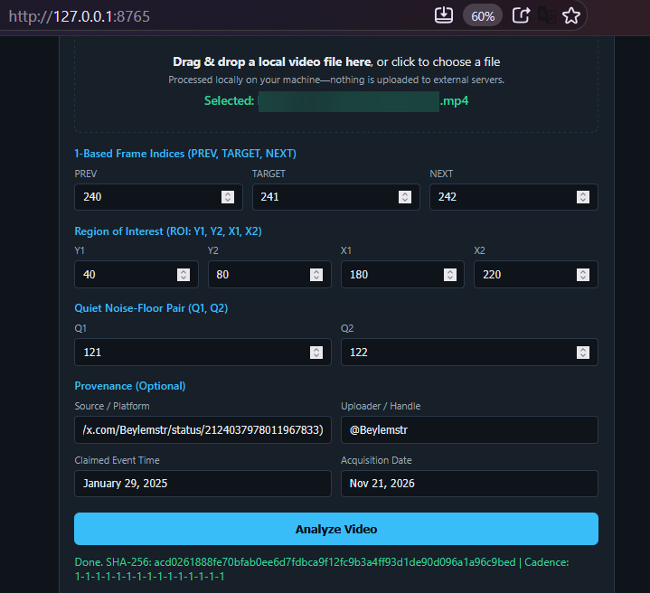

# overtpsyops-frame-check

**[Live UI Preview](https://tlthe5th.github.io/overtpsyops-frame-check/)** · Open-source CLI & local browser tool for testing disputed video frames through repeatable pixel, cadence, and alignment measurements.



> **Local PowerShell Setup (Full Video Analysis):** Download/extract the ZIP, run `python -m pip install -r requirements.txt` and `python server.py` in PowerShell, and open `http://127.0.0.1:8765`. *(The GitHub Pages link previews the static UI; full video analysis requires running `server.py` locally.)*

---

## Core Principle

Do not judge by appearance alone—measure the pixels, document the chain of custody, and state only what the data actually supports.

---

## What This Tool Measures

* **Chain-of-Custody Fingerprint (SHA-256):** Records the exact cryptographic hash of the local video file so anyone else can verify they are testing the identical file.
* **Stream & Repeat-Cadence Audit:** Inspects resolution, field order (progressive vs. interlaced), and frame-to-frame duplicate patterns (e.g., `3-1-3-3-2-2` vs. `1-1-1-1-...`) to distinguish variable-frame-rate (VFR) frame duplication from software motion interpolation or unique frames.
* **Linear Cross-Fade Blend Test ($\alpha$, MAE, $R^2$):** Tests whether a disputed frame ($N$) is a mathematical cross-fade of its neighboring frames ($N-1$ and $N+1$).
* **Subpixel Registration & Overlay:** Aligns neighboring frames via phase correlation before differencing, saving a 50/50 overlay (`overlay.png`) to expose or rule out spatial shifts and foreign splices.
* **Noise-Floor, Matched-Baseline Controls & Row Profiles:** Compares brightness changes in the target region against a quiet-frame noise floor and external patches of matching baseline brightness, alongside a 16×16 macroblock grid (`diff_16x16_grid.png`).

---

## What "Consistent With" Means

Pixel measurements establish where light changed, by how much (`0–255` scale), and in what frame sequence. They do not identify who filmed a video, what object produced a flash, or what political narrative surrounds it. Every report separates measured numbers from interpretation and lists explicit methodological limits.

---

## Installation & Quickstart

Requires **Python 3.10+** and **`ffprobe`** (from FFmpeg) installed on your system `PATH`.

```powershell
python -m pip install -r requirements.txt
python -m unittest discover -s tests -v
python server.py
```

Once `server.py` is running, open `http://127.0.0.1:8765` in your browser, select a local `.mp4` file, set your `PREV` / `TARGET` / `NEXT` frame indices, ROI coordinates (`Y1`, `Y2`, `X1`, `X2`), and quiet noise-floor pair (`Q1`, `Q2`), and click **Analyze Video**.
